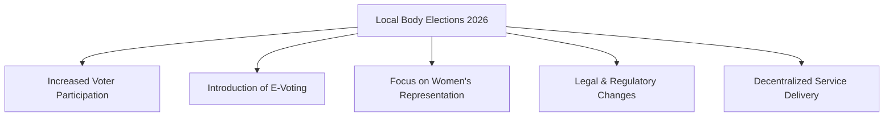

## Overview
Local body elections in Andhra Pradesh are crucial for local governance and community representation. Scheduled for March 2026, these elections will not only determine local leaders but also reflect broader trends in democratic participation and technological integration within the electoral process. Initiatives such as e-voting, increased focus on women’s representation, and enhanced voter awareness are set to reshape voter engagement and empower local communities.

## Pictorial representation

## Key points
- **Increased Voter Participation**: The Andhra Pradesh State Election Commission has initiated a voter awareness campaign to boost turnout, particularly among youth and marginalized groups.
- **Introduction of E-Voting**: An e-voting system has been implemented to enhance voting accessibility and security, with positive feedback from initial trials in Vijayawada.
- **Scheduling of Elections**: Elections are set for March 2026, with competitive contests anticipated in districts like Guntur and Visakhapatnam.
- **Legal and Regulatory Changes**: Amendments to bylaws now include stricter regulations on candidate asset disclosures to improve transparency and accountability.
- **Focus on Women’s Representation**: 50% of local body seats are reserved for women, promoting first-time candidates through skills training initiatives.
- **Decentralized Service Delivery**: Local bodies are given more control over budgetary decisions and infrastructure projects, exemplified by participatory budgeting in Tirupati.

## Examples
- The statewide voter awareness campaign includes collaboration with urban colleges for voter registration drives, aiming to educate youth about the importance of participating in local elections.
- E-voting trials in Vijayawada have shown improved voter experiences and quicker polling processes compared to traditional voting setups.
- The new regulatory framework demands candidates disclose their assets, helping to minimize corruption and enhance public trust in elected officials.
- The reservation of 50% of local governance seats for women aims to change the representation dynamics, evidenced by the emergence of numerous female candidates from rural backgrounds.
- Participatory budgeting in Tirupati allows citizens to suggest how local funds should be allocated, fostering a more inclusive decision-making process.

## Summary
The local body elections in Andhra Pradesh represent a significant opportunity for enhanced democratic engagement and governance reform. With the introduction of innovative voting methods, an emphasis on women's participation, and a commitment to legal transparency, these elections are poised to significantly impact the political landscape in the state. The initiatives being rolled out not only encourage broader community participation but also aim for a more responsible and accountable local governance structure.