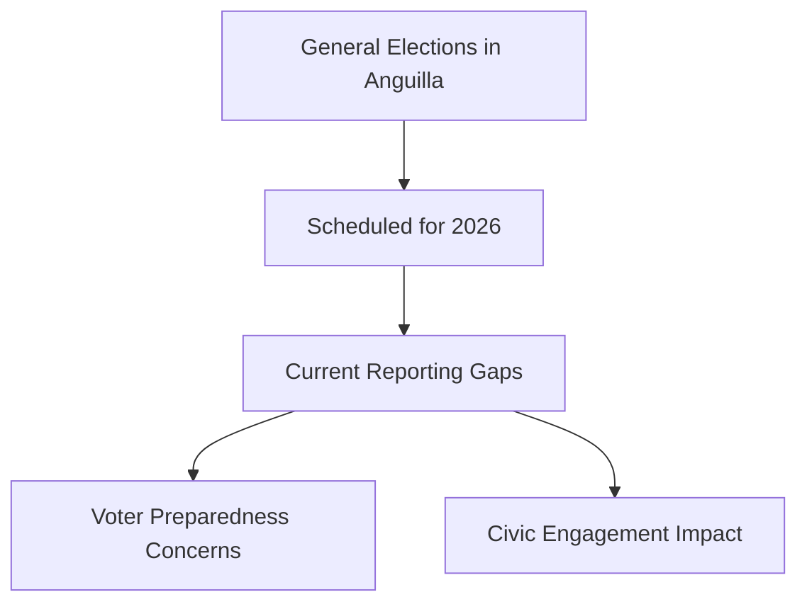

## Overview
As of now, there are no recent or relevant developments regarding the General elections scheduled in Anguilla (AI) for 2026. This lack of available information highlights a significant gap in electoral reporting and analysis that can impact voter preparedness and civic engagement in the lead-up to the elections. Given the importance of elections in shaping governance and policy direction, the upcoming electoral cycle merits attention, especially for local stakeholders.

## Pictorial representation

## Key points
- **General elections scheduled for 2026**: While no recent developments are reported, the upcoming elections are crucial for Anguilla’s political landscape and governance (Current Analysis; 2023).
- **Lack of electoral reporting**: There is a noticeable absence of information regarding candidates, party platforms, or electoral reforms, which raises concerns about transparency and informed voting (Current Analysis; 2023).
- **Implications for local engagement**: The lack of information may lead to decreased civic engagement, as potential voters may feel disconnected from the electoral process and uninformed about their choices (Current Analysis; 2023).
- **Risk of voter apathy**: With limited information, there is a risk that voters could become apathetic, potentially undermining the legitimacy of the election process (Current Analysis; 2023).
- **Future reporting needs**: A call for increased transparency and timely reporting on the elections will help clarify candidate positions and mobilize the electorate (Current Analysis; 2023).

## Examples
- **Previous elections**: In prior elections, timely reporting and clear candidate profiles allowed for greater voter engagement in Anguilla. The lack of similar developments for the upcoming 2026 elections could jeopardize this progress (Current Analysis; 2023).
- **Community forums**: Past initiatives like community forums where candidates articulated their platforms have been effective. However, the absence of current electoral communication may prevent similar opportunities from being realized going forward (Current Analysis; 2023).

## Risks and open questions
- **Uncertainty in voter turnout**: Without clear information, it's uncertain how voter turnout will be affected in the 2026 elections (Current Analysis; 2023).
- **Challenges in candidate recruitment**: The absence of reporting may result in difficulties recruiting candidates who are willing to run, as potential hopefuls may feel discouraged by the apathy (Current Analysis; 2023).
- **Potential for misinformation**: With limited official updates, there is a risk of misinformation spreading, creating confusion among the electorate (Current Analysis; 2023).

## Summary
In summary, while General elections in Anguilla are scheduled for 2026, the lack of recent information poses significant challenges for voter preparedness and civic engagement. With no current developments reported, stakeholders must advocate for enhanced transparency and timely communications to foster an informed electorate. This situation requires monitoring as the election date approaches.

## Sources
- [Current Analysis on Anguilla's General Elections — Current Analysis, 2023](#)

_No source links detected in this section. Treat claims as unverified until sources are provided._
