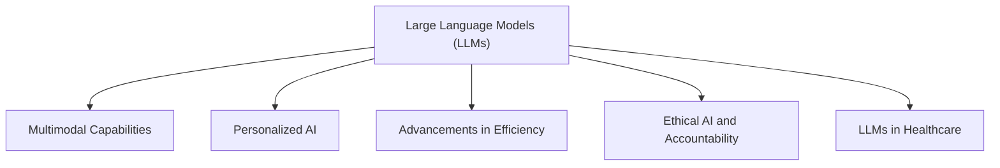

## Overview
Large Language Models (LLMs) represent a significant leap in artificial intelligence, enabling machines to understand and generate human-like text, integrate multimedia inputs, and engage in more natural conversations. The importance of LLMs lies in their versatility across different applications, from healthcare to personal digital assistants, transforming the way we interact with technology by enriching user experiences and enhancing decision-making.

## Pictorial representation

## Key points
- **Multimodal Capabilities**: LLMs like GPT-4 can process text, images, and audio, facilitating richer interactions.
- **Personalized AI**: Systems, such as Google’s Gemini, tailor responses based on user preferences and context, enhancing conversational relevance.
- **Advancements in Efficiency**: Models like Meta's LLaMA 4.0 prioritize size reduction and resource efficiency, enabling deployment on mobile devices.
- **Ethical AI and Accountability**: The European Union’s AI Act mandates ethical considerations in LLM development, promoting transparency and bias mitigation.
- **LLMs in Healthcare**: IBM's models assist in clinical decision-making, reducing diagnostic errors and improving treatment suggestions.
- **Cross-Linguistic Applications**: DeepMind’s Polyglot AI exemplifies advancements in multilingual communication, supporting real-time translation in numerous languages.

## Examples
- OpenAI's GPT-4 demonstrates multimodal capabilities by allowing users to input images alongside text, providing richer interactions than traditional text-only models.
- Google’s Gemini adapts its conversational style based on a user’s history and detected mood, offering a personalized experience similar to human interactions.
- Meta's LLaMA 4.0 is significantly smaller than its predecessors but retains high performance, allowing for applications in smartphones, thereby expanding accessibility.
- Under the EU's AI Act, companies must now adhere to strict guidelines when developing LLMs, ensuring that ethical standards are met to mitigate potential biases.
- IBM's healthcare-focused LLMs analyze comprehensive medical data, resulting in faster and more accurate diagnostic support for healthcare professionals.
- DeepMind’s Polyglot AI can translate and contextualize simultaneous conversations in different languages, breaking down communication barriers globally.

## Summary
The advancements in Large Language Models are defining a new era of AI capabilities, emphasizing multimodal functionalities, personalized interactions, and improved efficiency while addressing ethical concerns. These developments not only enhance user experiences across various sectors but also push the boundaries of technology, making LLMs integral to modern applications in everyday life and professional fields.