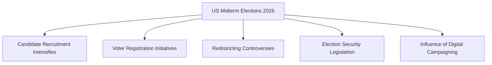

## Overview
The US midterm elections, occurring every four years halfway through a president's term, serve as a pivotal moment for voters to express their opinions on current leadership and policies. These elections not only determine the makeup of Congress but also influence state and local governments. As the 2026 midterms approach, critical developments like candidate recruitment, voter mobilization, and election security are poised to shape the political landscape, making it essential for citizens to stay informed.

## Pictorial representation

## Key points
- **Candidate Recruitment**: Both major parties are actively recruiting candidates, with figures like Florida Governor Ron DeSantis gaining traction for Senate primaries in key swing states.
- **Voter Registration Efforts**: Activist organizations are working to increase voter registration, exemplified by the League of Women Voters registering over 1 million new voters in 2023.
- **Redistricting Challenges**: Legal battles over redistricting in states like North Carolina and Texas could significantly shift electoral power dynamics ahead of the midterms.
- **Election Security Discussions**: Bipartisan support is building for new legislation to enhance security for electronic voting systems, reflecting heightened concerns over election integrity.
- **Current Issue Influence**: Social issues, particularly abortion rights and gun control, are expected to shape campaign strategies and voter turnout.
- **Digital Campaign Strategies**: With 70% of voters engaging with campaigns on social media, candidates are increasingly relying on digital platforms for outreach and voter mobilization.

## Examples
- Florida Governor Ron DeSantis is emerging as a strong candidate within the GOP for the 2026 Senate race, potentially challenging incumbent Democrats in competitive states.
- The League of Women Voters' efficient voter registration drive highlights how technological advancements are making it easier for citizens to register, which is crucial in crucial swing states.
- North Carolina's and Texas's redistricting maps are facing judicial scrutiny, which could lead to significant electoral shifts, showcasing the impact of demographic adjustments.
- Bipartisan proposals in Congress aim to enhance voting system security protocols, reflecting a growing prioritization of safeguarding the electoral process.
- Polls indicate that young voters are particularly energized about abortion rights, a key issue expected to drive higher Democratic turnout.
- Candidates' social media strategies, which constitute 70% of voter engagement, suggest a shift in how campaigns are conducted, underscoring the importance of digital presence.

## Summary
As the 2026 US midterm elections approach, a convergence of factors—candidate recruitment efforts, voter registration initiatives, redistricting controversies, and rising digital campaigning—is shaping a dynamic electoral landscape. Understanding these developments is crucial for anticipating shifts in voter behavior and the potential outcomes of the elections. Engaging with these issues will help ensure informed voting and participation in the electoral process.